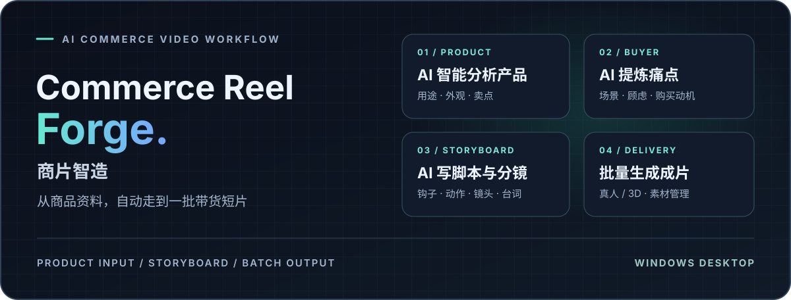

# 商片智造 · Commerce Reel Forge

**AI 自动分析产品和买家痛点，写出脚本与逐镜分镜，再批量生成带货素材。**

从商品参考图和卖点说明开始。选择数量和交付方式、启动任务后，工作台依次完成分析、创意策划与写稿。你可以先审分镜，也可以直接让工作台生成视频。

[**下载 Windows 发行版**][download]　·　[查看版本与文件校验][release]　·　[反馈问题][issues]

## AI 在每一步交付什么？

| 阶段 | AI 处理什么 | 你拿到什么 |
| :--- | :--- | :--- |
| **01 · 产品分析** | 整理商品参考图、补充说明和可用商品资料 | 产品用途、外观要点、功能与核心卖点 |
| **02 · 痛点分析** | 从使用场景推断消费者可能遇到的麻烦、犹豫点和购买动机 | 可以拍成画面的冲突、需求与展示角度 |
| **03 · 脚本与分镜** | 按钩子、卖点或联合创作写稿，将创意拆成镜头 | 逐镜画面、人物动作、台词或声音安排，以及可审阅分镜 |
| **04 · 批量成片** | 按选定时长、分辨率和画面形式运行生成任务 | 多条成片，集中查看并批量下载；联合创作可拼接两段 |

## 同一个产品，可以怎么拍？

| 创作模式 | 适合交付 |
| :--- | :--- |
| **钩子创作** | 独立广告开场：用冲突、反差或悬念抓住注意力。真人钩子可选脚本模板，也可以让 AI 按商品匹配创作角度。 |
| **卖点展示** | 独立演示：围绕具体使用场景，拍清怎么用、能看到什么变化。 |
| **联合创作** | 分开制作钩子与卖点段，再拼成一条完整素材；两段默认各 15 秒。 |

支持 **真人生活场景 / 3D 动漫人物**、**仅写脚本 / 脚本＋视频**，内置 **10 套脚本模板**。常用资料可保存到本地产品库，在后续批次复用。

## 从一件商品开始

1. 下载 [Windows ZIP][download]，完整解压后打开 `U Studio.exe`。同目录附《U Studio 简明使用说明.pdf》。
2. 导入商品图，补充真实卖点、用途或商品网址；也可从产品库载入。
3. 选择创作模式、数量和交付形式，在「批次与素材」启动任务。
4. 可以先用模拟模式熟悉流程；真实模式需自行配置 Atlas Key，按模型服务商账单计费。

> 买家痛点与购买动机是基于你提供的商品资料推断，不等于市场调研。任务由本机管理，真实生成所需资料会发送给模型服务商。仓库分发 Windows 发行包，不提供应用源码。

[download]: https://github.com/u1twwww-gif/commerce-reel-forge/releases/latest/download/U-Studio-Local.zip
[release]: https://github.com/u1twwww-gif/commerce-reel-forge/releases
[issues]: https://github.com/u1twwww-gif/commerce-reel-forge/issues
